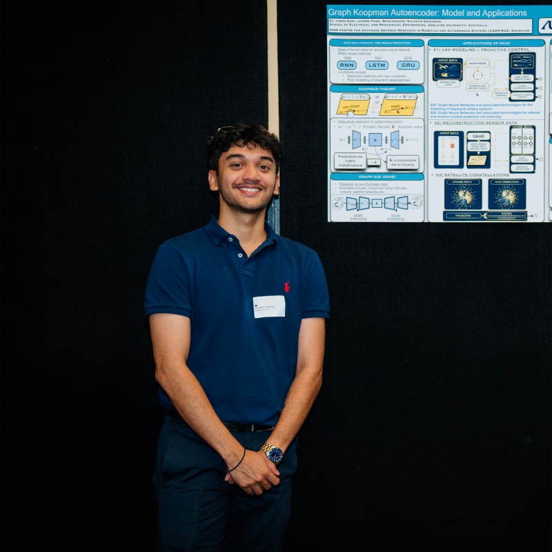

  

    
    

      <h1 style="margin: 0 0 4px 0; font-size: 1.75em; color: #1a1a1a; border-bottom: none; padding-bottom: 0; line-height: 1.2;">Dr. Sivaram Krishnan</h1>
      
Postdoctoral Research Fellow

      

        School of Electrical and Mechanical Engineering &amp; Defence and Space Lab 
        Adelaide University, Australia
      

      

        <a href="mailto:sivaram.krishnan@adelaide.edu.au" style="text-decoration: none; background: #ffffff; color: #333; padding: 4px 10px; border-radius: 6px; font-size: 0.82em; border: 1px solid #ced4da; font-weight: 500;">📧 Email</a>
        <a href="https://scholar.google.com/citations?user=3HX0ZDMAAAAJ&hl=en" target="_blank" style="text-decoration: none; background: #4285f4; color: #ffffff; padding: 4px 10px; border-radius: 6px; font-size: 0.82em; font-weight: 500;">Google Scholar</a>
        <a href="https://www.linkedin.com/in/sivaram-krishnan11/" target="_blank" style="text-decoration: none; background: #0a66c2; color: #ffffff; padding: 4px 10px; border-radius: 6px; font-size: 0.82em; font-weight: 500;">LinkedIn</a>
      

      

        Spatiotemporal ML
        Graph Learning
        6G NTN
        Reinforcement Learning
        Computer Vision
      

    

  

## About Me

I am a Postdoctoral Research Fellow at **Adelaide University**, working on machine learning for wireless and satellite networks. My work applies spatiotemporal modelling, time-series forecasting and sequential decision-making to problems such as routing and congestion control in satellite mega-constellations, in collaboration with ETRI (South Korea). I also develop computer-vision models for space-based surveillance at the Defence and Space Lab, as part of the iLAuNCH Trailblazer program.

I completed my Ph.D. at Adelaide University in 2026, supervised by Prof. Jinho Choi, A/Prof. Jihong Park and A/Prof. Brian Ng.

---

## Research Interests

* **AI for Wireless and Satellite Networks:** forecast-driven routing and congestion control, software-defined control of mega-constellations, covert communication.
* **Spatiotemporal and Graph Learning:** time-series forecasting, Koopman-based models of network dynamics, federated learning.
* **Sequential Decision-Making:** reinforcement learning for routing and access in satellite–terrestrial networks.
* **Computer Vision for Space:** infrared small-target detection and efficient on-board inference.

---

## Recent News

* **[2026]** – Paper submitted: *"Forecast-Driven Queue Management and Routing in LEO Constellations"* to *IEEE Networking Letters*.
* **[2026]** – Major revision: *"Toward Scalable SDN for LEO Mega-Constellations: A Graph Learning Approach"* in *IEEE Communications Magazine*.
* **[2026]** – Ph.D. conferred by Adelaide University.
* **[2026]** – Joined the Defence and Space Lab, Adelaide University, working on AI for space-based surveillance (iLAuNCH Trailblazer).
* **[2026]** – Paper accepted: *"Reinforcement Learning for Opportunistic Routing in Software-Defined LEO–Terrestrial Systems"* in *IEEE Wireless Communications Letters*.
* **[2025]** – Paper accepted: *"Learning Time-Varying Graph Signals via Koopman"* in *IEEE Transactions on Signal and Information Processing over Networks*.
* **[2025]** – Presented research at **IEEE ICASSP 2025** and **IEEE IJCNN 2025**.

---

## Teaching

### Adelaide University

* **Mobile Communications and Wireless Access** (Semester 2, 2026) – Sessional Teaching Assistant
* **Engineering Programming** (Semester 1, 2026) – Sessional Teaching Assistant
* **Signal Processing Applications** (Semester 1, 2025) – Sessional Teaching Assistant

### Deakin University

* **Research and Development in Information Technology** (Trimester 1, 2023 and 2024) – Sessional Teaching Assistant

---

## Education

* **Ph.D. in Engineering** | Adelaide University (2022 – 2026) *Thesis: Graph-Based Methods for Prediction and Control in Dynamic Non-Terrestrial Networks*
* **Master of Data Science** | Deakin University (2020 – 2022)
* **Bachelor of Computer Engineering** | Sinhgad Academy of Engineering (2014 – 2018)
